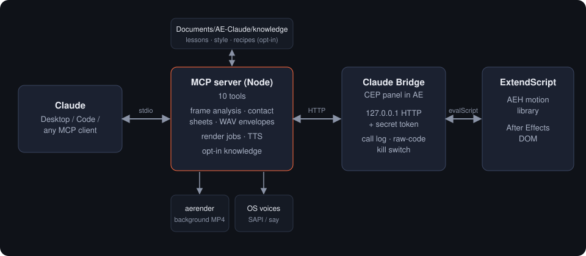
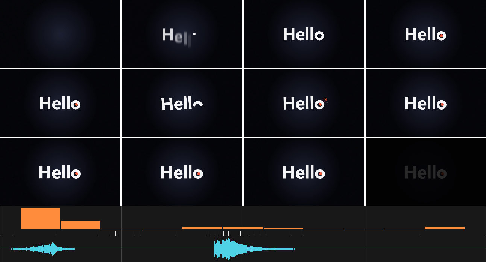

# After Effects MCP Pro

**Let Claude work inside Adobe After Effects like a senior motion designer. It builds, sees, critiques and renders, and it spends as few tokens as possible doing it.**


*Built by Claude in After Effects from one sentence: "a quick, very professional clip with a simple sound that says hello with a wink".*

[العربية](README.ar.md)

---

## Why another After Effects MCP?

Most After Effects MCP servers expose a fixed list of commands, such as "create text layer" or "set keyframe", and leave the model blind: it never sees what it made. AE MCP Pro takes a different approach:

| | Typical AE MCP | **AE MCP Pro** |
|---|---|---|
| What Claude can do | A dozen fixed commands | **Anything scriptable**, through ExtendScript plus a pro motion library |
| Can Claude see the result? | No | **Yes**: frame grids plus a motion, keyframe and audio timeline |
| Quality control | None | **Automatic checks**: safe area, empty frames, linear keys, motion blur, audio sync |
| References | — | **Analyse a reference video, image or song** (beats → markers), then **compare your comp side by side** |
| Safety | — | **Checkpoints + revert**, read-only mode, every call logged |
| Expertise | — | **On-demand expert guides** (transitions, type, camera, audio sync, expressions, delivery, references) |
| Rendering | In-app (freezes AE) or none | **Background `aerender`**, so AE stays usable |
| Voice-over | — | **Built-in TTS** with OS voices |
| Transport | Often polled JSON files | **Local HTTP with a secret token**, results returned in the same call |
| Token cost | Not measured | **Measured and optimised** ([see below](#token-efficiency)) |

## How it works



1. A **CEP panel** called *Claude Bridge* runs inside After Effects. It listens on `127.0.0.1` with a secret token, logs every call, and has a switch that turns off raw code execution.
2. An **MCP server** (Node, packaged as a one-click Claude Desktop extension) exposes 14 tools. It handles the heavy lifting outside AE: frame analysis, contact sheets, WAV envelopes, background renders and TTS.
3. Claude's code runs in AE's ExtendScript engine, with **AEH**, a motion-design library that turns a page of boilerplate into one line.

## Tools

| Tool | What it does |
|---|---|
| `ae_status` | Bridge check: AE version, project, active comp |
| `ae_inspect` | Project items, or a comp's layers, timing, parents, effects and animated or expression-driven properties |
| `ae_run_jsx` | Runs ExtendScript with full DOM access and the AEH library, as one undo step |
| `ae_preview` | Returns frames as an image grid; `ui: true` screenshots the After Effects window itself |
| `ae_review` | **Expert review**: frame grid, timeline strip and automatic checks (see below). It also **scores music sync**: every cut and big moment (inside precomps too) against the song's beat hits, and flags off-beat or too-fast cuts. With `reference`, a side-by-side comparison against a video |
| `ae_reference` | Analyses a reference: image, video (fps, cuts, motion rhythm) or **music (BPM, beat grid, strong hits → comp markers)** |
| `ae_checkpoint` | Project snapshots before risky edits; revert (always snapshots the current state first) |
| `ae_guide` | Loads one expert cookbook on demand: transitions, typography, camera-3d, audio-sync, expressions, deliver, reference |
| `ae_render` / `ae_render_status` | Background H.264 render via `aerender`, with progress |
| `ae_tts` | Generates a voice-over WAV with Windows SAPI or macOS `say` voices |
| `ae_music` | Royalty-free **music library**: adds downloaded tracks after a license check, measures BPM/beats/energy, finds the right track for a brief. `use` returns a **rhythm map** (cut pulse, quiet/loud sections, drops, breaks, strongest hits), drops typed markers and can trim the track so the drop lands where you want (`drop_at`) |
| `ae_fonts` | Lists installed fonts, installs free **Google Fonts** (OFL only, per user, no admin), and previews 3 options side by side so you can pick |
| `ae_memory` | **Technique cards** learned from references (saved automatically, you can delete them), lessons and recipes; your personal style only when you ask |

### The visual review



Under the frames is a timeline. **Orange** bars show how much moves between samples. **White** ticks are keyframes. **Cyan** is audio loudness. Grey lines mark seconds. In this example you can read the beats straight off the strip: the letters reveal at the start, the wink lands mid-clip together with its chime and a cluster of keyframes, then the clip holds and fades. Alongside the image, Claude gets a text report:

```
Motion: most motion: 0.17–0.5s; still/holds: 1.17–1.5s, 2.83–3.5s; brightness change (fade?): 3.5–3.83s
Audio: whoosh.wav: starts 0.00s, loudest around 0.43s; wink_chime.wav: starts 1.76s, loudest around 1.87s
Checks: no issues found
```

The motion measure is normalised per frame, so a fade to black is reported as a brightness change, not as motion. Checks include content touching the frame edge, empty frames, linear keyframes, moving layers without motion blur, keyframes after the comp ends, layers outside the time range, and missing footage, and expression errors.

With `reference: "C:/refs/intro.mp4"` the grid pairs your frames with the reference at the same normalised times, and the report gives layout similarity per moment, a motion-rhythm correlation (1 = same timing) and average colours. The strip then shows your motion in orange and the reference's in violet.

### AEH: the motion library

```js
var t = AEH.text(comp, "Hello", { size: 280, color: "#F5F5F7" });     // centred on its visual centre
AEH.textAnim(t, "rise", { start: 0.1, dur: 0.8 });                   // per-character reveal
var ring = AEH.shape(comp, "ellipse", { size: [120, 120], stroke: "#fff", width: 30 });
AEH.drawOn(ring, 0.45, 0.95, "out");                                 // trim-path draw-on
AEH.anim(AEH.prop(ring, "ADBE Transform Group/ADBE Scale"),
         [[1.72, [100,100,100]], [1.8, [100,0,100]], [2.1, [100,110,100]], [2.2, [100,100,100]]], "smooth");
AEH.expr(AEH.prop(ring, "ADBE Transform Group/ADBE Rotate Z"), "wiggle", { freq: 2, amp: 4 });
AEH.audio(comp, "C:/sfx/chime.wav", 1.76, -7);
```

* **Curves**: `ease` `smooth` `out` `in` `expo` `snap` `linear` `hold`
* **Text presets**: `rise` `drop` `pop` `blur` `fade` `typewriter` `tracking`, by character, word or line
* **Expression presets**: `wiggle` `bounce` (inertial overshoot) `loop` `pingpong` `spin` `follow` `blink`
* **Other helpers**: `shape` (rect, ellipse, star, path), `drawOn`, `bg` (gradient background), `fx` (any effect plus its params by name), `precompose`, `stagger`, `marker`, `audio`, `importFile`, `listEffects`, and `recipe` (runs your own saved snippets)

The full example is in [`examples/hello-wink.jsx`](examples/hello-wink.jsx).

## Token efficiency

Measured with `npm run bench`. Counts use the Claude tokenizer from `@anthropic-ai/tokenizer`, which is close to but not identical to current models. Image cost uses Anthropic's formula, ≈ width × height / 750 after downscaling.

| What | Before optimisation | **Now** | Saving |
|---|---:|---:|---:|
| Tool definitions (sent with every turn) | 1,625 (10 tools) | **1,568 (14 tools)** | −4 % total, 112 tokens per tool vs 163 (14 tools now) |
| `ae_inspect` of a 10-layer animated comp | 1,430 | **518** | −64 % |
| Code Claude writes for the hello-wink clip (raw ExtendScript vs AEH) | 4,001 | **1,362** | −66 % |
| `ae_preview`, single frame | 1,229 | **786** | −36 % |
| `ae_preview`, 6-frame grid | 1,231 | **1,050** | −15 % |
| `ae_review`, 12 frames plus timeline | 1,533 | **1,202** | −22 % |

For comparison, the original fixed-command [after-effects-mcp](https://github.com/Dakkshin/after-effects-mcp) spends **2,085 tokens** on 13 tool definitions. AE MCP Pro spends 1,088 on 12 tools that can do far more.

How it stays lean:

* **Compact responses**: JSON without whitespace. `ae_inspect` sends only non-default fields and shortens property paths.
* **One call instead of many**: `ae_review` returns frames, timing analysis, audio sync and QA checks together. `ae_run_jsx` can build a whole scene section in one step.
* **The library does the boilerplate**: Claude writes intent (`textAnim(t, "rise")`), not 40 lines of property plumbing.
* **Right-sized images**: big enough to judge layout and motion, small enough to be cheap. Pass `width` when you need detail.
* **Lean schemas**: `tools/list` drops `$schema`, `title` and `execution` noise (~30 tokens per tool, every turn).
* **Knowledge on demand**: the seven expert guides (430–930 tokens each) load only when a task needs one, instead of living in a big always-on prompt.
* **Text, not images, where text is enough**: beat analysis and checkpoints return a few lines; images only when Claude has to *see*.
* **Opt-in memory**: nothing is injected into context unless you ask Claude to use your saved style or recipes.

## Install

> 📘 **Full step-by-step guide, daily usage and troubleshooting: [docs/SETUP.md](docs/SETUP.md)**

**Requirements:** After Effects 2022 or later (tested on 2026 / 26.3), Claude Desktop, and Windows 10/11. macOS support is written but untested.

1. **Panel**: clone the repo (`git clone https://github.com/malkawi06/After-Effects-mcp-pro`), then run:
   * Windows: `powershell -ExecutionPolicy Bypass -File install\install-windows.ps1`
   * macOS: `sh install/install-macos.sh`

   The installer copies the panel to your user CEP extensions folder and enables `PlayerDebugMode`, which unsigned panels need.
2. **After Effects**: go to Preferences → Scripting & Expressions and tick **Allow Scripts to Write Files and Access Network**. Restart AE. Under **Window → Extensions → Claude Bridge** you should see a green dot.
3. **Claude Desktop**: download [`after-effects-mcp-pro.mcpb`](https://github.com/malkawi06/After-Effects-mcp-pro/raw/main/install/after-effects-mcp-pro.mcpb) (in the `install` folder), then go to Settings → Extensions → Install Extension and choose it. It runs on Claude Desktop's built-in Node, so there is nothing else to install.
4. **Optional:** add [`skill/SKILL.md`](skill/SKILL.md) as a Claude skill. It holds the workflow and the senior motion-design rules for timing, easing, layout, type, colour and sound levels.

## Try it

> "Make a 5-second 1080×1920 promo for 'NASA Space Apps Irbid': bold kinetic type, one accent colour, a whoosh on each word, and render it."

> "Here's a reference: `C:\refs\intro.mp4`. Rebuild it with my logo and make the easing smoother."

> "Open my comp *Lower Third*, review it, and fix whatever looks amateur."

> "That wink was great. Save it as a recipe called `wink-o`." *(and next time: "use my wink-o recipe on the word Hello")*

## Security

* The panel listens **only on 127.0.0.1**, requires a random token (stored in `~/.ae-claude-bridge.json`), accepts JSON only, and rejects any request carrying a browser `Origin`/`Referer`.
* **Read-only** switch in the panel: Claude can inspect, preview and review, but not change the project.
* `ae_checkpoint` snapshots the project before risky edits; revert never loses work (it snapshots the current state first).
* Every call is logged in the panel. Untick **Allow Claude to run raw ExtendScript** to block arbitrary code; the fixed tools keep working.
* ExtendScript runs with After Effects' own permissions. Use it with clients and prompts you trust.

## Limits

These features have no scripting API, so Claude can only reach them through screen control: Roto Brush, Content-Aware Fill, Camera/3D Tracker analysis, Puppet pin creation, AI generative features, and custom plugin UIs. Claude judges motion from sampled frames and numbers. It does not watch or hear the clip in real time, so your eye on the final render still matters.

## Development

```bash
cd server
npm install
npm run build   # bundle to dist/
npm test        # 53 checks: MCP end-to-end (mock bridge), panel security, AEH library
npm run bench   # token benchmark
npm run pack    # build after-effects-mcp-pro.mcpb
```

```
panel/      CEP panel: manifest, HTTP bridge (main.js), ExtendScript host + AEH library (host/host.jsx)
server/     MCP server (src/index.js), tests, token benchmark, extension manifest
skill/      Claude skill with workflow and motion-design rules
install/    Windows/macOS installers and registry file
examples/   hello-wink.jsx, written with AEH
docs/       images used in this README
```

## Status

v1.2. 53 automated checks pass. Live on After Effects 2026 (26.3, Windows 11): the panel, `ae_status`, `ae_tts` and `ae_run_jsx` with the AEH library were verified. The live session also caught an ExtendScript quirk (chained `a ? b : c ? d : e` is mis-parsed), which is now fixed and documented. The demo above was rendered in After Effects.

## Developer

**Mohammad Malkawi** · [@malkawi06](https://github.com/malkawi06)

Computer Networks & Cybersecurity student from Jordan, building at the intersection of AI, design and hardware. Mohammad designed and directed After Effects MCP Pro: the idea, the requirements (expert-level output, visual self-review, opt-in memory, minimal token cost) and the testing on a real After Effects setup. The code was written in collaboration with Claude (Anthropic) as an AI pair-programmer.

Issues, ideas and pull requests are welcome.

## License

MIT © Mohammad Malkawi
